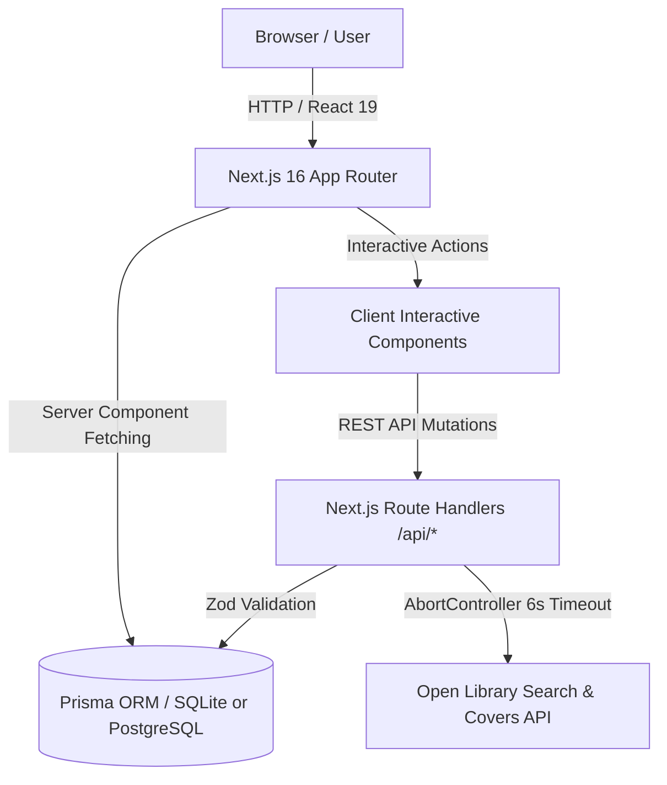

# Grimmoire Architecture & Technical Design

> *"Every volume represents a journey undertaken, a memory engraved in parchment, and a flame against the dark."*

Grimmoire is an atmospheric personal digital library and reading chronicle designed as an immersive living castle archive. This document outlines the system architecture, component hierarchies, data flow, and design decisions.

---

## 1. System Overview

Grimmoire is built on **Next.js 16 (App Router)**, **React 19**, **TypeScript**, and **Prisma ORM**. The application merges tactile dark-academia aesthetics (gold foil, mahogany bookcases, two-page parchment manuscripts, celestial observatories) with reliable, high-performance web engineering.

---

## 2. Architectural Layers

### A. Presentation Layer (`app/` & `components/`)
- **Server Components by Default**: Pages such as the Entrance (`/`), Library (`/library`), Book Details (`/books/[id]`), Departments (`/departments`), Journal (`/journal`), Observatory (`/observatory`), and Settings (`/settings`) execute server-side data queries via Prisma.
- **Client Components for Interactivity**: Client components (`"use client"`) are strictly isolated to interactive subsystems:
  - `components/library/Bookshelf.tsx`: 2D wooden bookshelf, responsive layout, search/filters, tier grouping.
  - `components/books/BookSpine.tsx`: Deterministic spine rendering, hover motion, keyboard accessibility (`Enter`/`Space`), and reduced-motion detection.
  - `components/books/BookOpeningModal.tsx` & `AddBookModal.tsx`: Accessible dialogs for scribing and inspecting tomes.
  - `app/settings/SettingsClient.tsx`: Goal tuning, versioned archive export, and dry-run backup restoration.

### B. Validation & Domain Logic (`lib/`)
- **Validation Boundaries (`lib/validations/`)**: All mutations at `/api/*` and file uploads are strictly parsed at runtime using **Zod** (`book.ts`, `journal.ts`, `session.ts`, `backup.ts`).
- **Statistical Calculation Engine (`lib/stats.ts`)**: Centralized, pure calculation functions (`calculatePagesRead`, `calculateReadingStreak`, `calculateGoalProgress`) derive all numbers directly from persisted database records.
- **Metadata Normalization (`lib/books/normalize.ts`)**: Normalizes disparate external book schemas (Open Library) into a clean internal `NormalizedBookMetadata` model.

### C. Data Persistence Layer (`prisma/`)
- **Dual Database Compatibility**:
  - **Local Development**: SQLite (`file:./dev.db`) provides an instant, zero-config local environment requiring no Docker or background database servers.
  - **Hosted Production**: PostgreSQL (`prisma/schema.postgresql.prisma`) supports Supabase, Neon, Railway, or AWS RDS.
- **Server-Side User Scoping**: The application architecture scopes records to `userId` using `lib/auth.ts`. Client requests never supply or overwrite ownership keys.

---

## 3. External Metadata Integration

External book discovery integrates with the Open Library Search and Covers API:
1. **Sanitization**: Query strings are trimmed, length-verified (minimum 2 characters), and URI-encoded.
2. **Resilience & Timeout Handling**: Network requests use `AbortController` with a 6-second server timeout. Search failures fail gracefully to an empty array rather than disrupting the application.
3. **Request Cancellation**: Client-side searches cancel stale pending requests when new terms are entered.
4. **Artwork Fallbacks**: When Open Library does not possess high-resolution covers, a decorative gothic parchment cover card is rendered automatically.

---

## 4. Archive Backup & Recovery Engine

To guarantee user data sovereignty, Grimmoire implements a complete, versioned backup engine:
- **Format**: JSON archive adhering to `GrimmoireArchiveBackupSchema` (`version: "1.0.0"`).
- **Contents**: Full archive containing all books, quotes, reading sessions, departments, journal entries, and annual reading goals.
- **Non-Destructive Restoration**:
  - **Dry-Run Preview**: Inspects the file, checks schema version compatibility, and reports exact counts of new tomes and preserved existing tomes without touching the database.
  - **Duplicate Protection**: Existing books (matched by normalized title or ISBN-13) are preserved and never overwritten.
  - **Transaction Boundaries**: Restores records in a single Prisma transaction to ensure atomicity.

---

## 5. Accessibility & Design System

- **Reduced Motion**: All Framer Motion animations check `useReducedMotion()`. When preferred, dramatic translation and scale effects are disabled in favor of subtle opacity shifts.
- **Keyboard Navigation**: Interactive book spines, filter dropdowns, and cards feature accessible keyboard focus indicators (`focus-visible:ring-2 focus-visible:ring-[#C5A56A]`).
- **Typography & Palettes**: Uses Google Fonts `Cinzel` (display) and `Plus Jakarta Sans` (body) against deep walnut (`#21162E`, `#39251F`), midnight violet (`#100D18`), and antique gold (`#C5A56A`).
